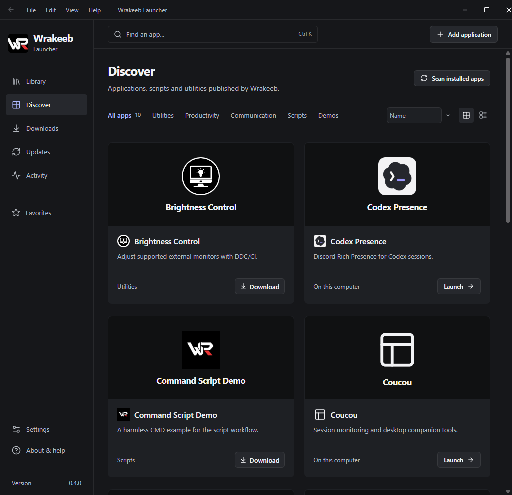
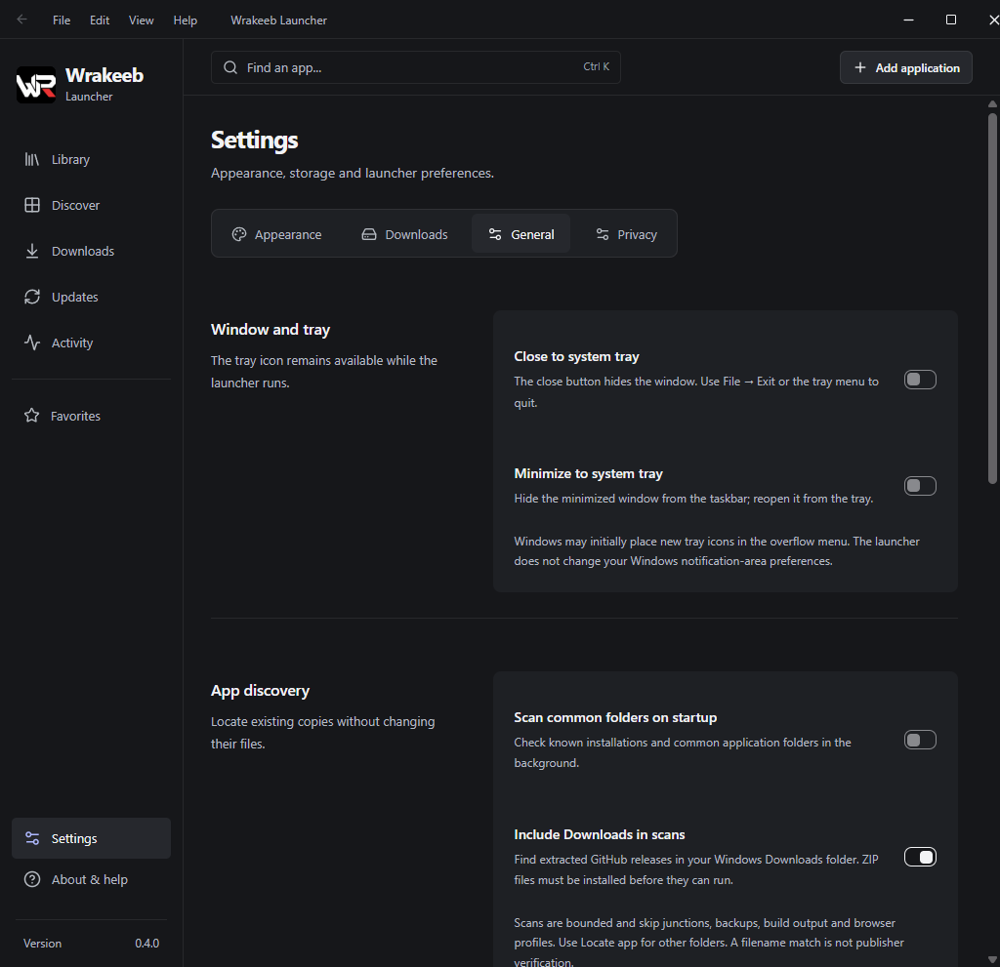

# Wrakeeb Launcher

Applications, scripts and utilities in one Windows desktop library. Version **0.4.0** improves discovery, direct downloads, tray behavior and project details.

## Install on your PC

Download the **Windows x64 setup executable** from [Releases](https://github.com/w-rakeeb/wrakeeb-launcher/releases/latest). Setup installs for the current Windows user, creates Start menu/desktop access and checks for Microsoft WebView2. An internet connection is needed if the runtime must be downloaded. No D: drive, fixed username or development tools are required.

Target platforms: **Windows 10 22H2 x64 and Windows 11 x64**. Built and tested locally on Windows 11. A separate Windows 10 machine has not yet been tested; ARM64 and 32-bit packages are not provided. The executable and setup are not Authenticode-signed.

A portable ZIP is also available. Extract it to a writable folder and run **Wrakeeb Launcher.exe**. Keep its adjacent data folder when upgrading or moving it. Existing portable libraries remain compatible.

## Try a real installation

1. Open **Discover → Launcher Demo**.
2. Download **Launcher-Demo-1.0.0.zip** from the live GitHub release files.
3. Choose **Install package**, then **Launch installed app**.
4. Close the launcher: the independently installed demo keeps running.

The demo needs .NET Framework 4.8. Its optional sample note is stored under your Windows user profile. **Command Script Demo** is a separate, harmless CMD sample. Its source is included under examples/LauncherDemo.

## Working features

- Curated applications, scripts and demonstration packages, with precise descriptions and original screenshot galleries.
- Live GitHub release tag/date, repository description, release notes, asset names/sizes and checksums. Repository/release-history links open the publisher's source.
- Direct downloads for release assets; curated portable ZIP, EXE and script installation. No automatic execution after downloading or installation.
- Separate configurable download and application-installation directories in **Settings → Downloads**.
- Byte progress, cancellation, verification results, persistent transfer feedback and explicit install/launch actions. One project package operation at a time.
- Independent version folders, with previous versions retained and a local installation receipt. Installing a new package switches its library link; application-data migration is not automatic.
- Link trusted local .exe, .cmd, .bat and .ps1 files with **Add application**. PowerShell follows the user's existing execution policy. Command script paths reject shell control characters.
- Search, categories, favorites, grid/list views, recent-use sorting, missing-file feedback and activity history.
- Dual Discord default, Original charcoal, Slate and Corporate light palettes; default/blue/teal/red/amber accent selection; compact layout and reduced motion.
- Native integrated title bar, keyboard-accessible settings tabs and a desktop-shortcut action in **Settings → General**.
- Separate optional launcher update checks, persistent version/check feedback, verified download, executable backup/replacement/restart and failed-start rollback.

## Package boundaries

Native code pins each catalog project's GitHub repository and approved entry-point filename. Downloads require GitHub HTTPS release URLs, expected size and the GitHub SHA-256 asset digest. ZIP extraction rejects traversal, links, duplicate paths and excessive size/file counts. Installation uses a fresh folder, verifies the entry point, then saves its library record. A corrupt or changed package does not replace an existing installation.

SHA-256 checks establish integrity against GitHub metadata; they are not publisher signatures or a security audit of every application. Each project retains its own requirements, licenses and behavior. Installer-style EXEs/MSIs, source archives and other files may require manual setup; there is no arbitrary silent-installer execution. Coucou is a neutral source entry and Vencord Auto Repair is a direct-download entry rather than managed installation recipes.

Pause/resume, a multi-package queue, managed app uninstall/repair, automatic app-data migration, automatic catalog-app updates and publisher signing are not implemented. Remove from library removes a link and preserves files. Each app's own updater remains independent.

## Data and recovery

| Location | Contents |
|---|---|
| Launcher folder/data/library.json | Links, installation receipts, preferences and recent activity |
| Launcher folder/data/library.json.bak | Previous successful library state |
| Launcher folder/data/webview/ | Embedded browser profile |
| Launcher folder/data/package-operation.json | Latest package-operation receipt/status |
| Launcher folder/data/launcher-update.json | Launcher update feedback |
| %LOCALAPPDATA%/Programs/Wrakeeb Launcher/{project}/Downloads/ | Default project downloads unless changed |
| %LOCALAPPDATA%/Programs/Wrakeeb Launcher/{project}/Versions/ | Independent application installations unless changed |
| Launcher folder/Backups/Launcher-update-* | Previous executable from a launcher update |

The current-user installer uses a writable per-user installation folder; the portable edition must also be kept writable. No library/profile data is shipped in release packages. Back up your entire launcher data folder and your independent application folders before moving PCs or rolling back. Unreadable/unsupported library data is preserved and reported.

Use [version history and restoration instructions](docs/VERSION-HISTORY.md). Releases are retained; existing public assets are not replaced. Archive bundles preserve recovered 0.1.0/0.1.1 executables and the original source snapshots, with their completeness limitations documented.

## Development

Node.js 24, Rust 1.98 Windows MSVC, Microsoft C++ build tools and WebView2 are required.

```powershell
npm ci
npm run desktop
npm test
npm run test:native
npm run package:installer
```

For browser tests, start npm run preview, then npm run test:ui. The browser preview cannot execute Windows programs. Native smoke and live package tests use isolated copies under runtime, with visible windows on a second monitor. The debug package test needs the preview server; production builds embed the UI. For the live launcher upgrade test, supply an authentic earlier release using WRAKEEB_PREVIOUS_BINARY. A localhost debugging endpoint is enabled only by test-launch environment variables.

See [status](docs/STATUS.md), [changelog](docs/CHANGELOG.md), [catalog publishing guide](docs/CATALOG-PUBLISHING.md), [image provenance](docs/PROJECT-IMAGES.md), [research](docs/LAUNCHER-REFERENCES.md), and the [roadmap](docs/ROADMAP.md).

Third-party artwork remains with its owners; see [Coucou's original notice](docs/Coucou-asset-notice.md) and the [design-reference license](docs/Dual-Discord-reference-license.txt). No third-party app binaries are bundled into the launcher itself.

## Screenshots





## New in 0.4.0

Compact File/Edit/View/Help menus replace the breadcrumb. Project pages separate Overview, Downloads and Information, with previous/next gallery controls and readable package state. Cards download the latest recommended package directly. Scan and Locate detect existing applications, including Dual Steam, without launching them. Native tray actions support Open, Settings and Exit, with optional close/minimize-to-tray. Settings add startup scanning, history privacy and larger text.

New users default to the writable current-user Windows Programs folder named Wrakeeb Launcher, with per-project Downloads and Versions subfolders. Existing explicit folder choices and legacy receipts remain intact; no files are silently moved. Folder controls are available beside package operations.

Read [privacy](PRIVACY.md), [security boundaries](SECURITY.md), [rights review](docs/RIGHTS-REVIEW.md) and [dependency notices](docs/THIRD-PARTY-NOTICES.txt). Coucou artwork is omitted from v0.4.0 because permission is unconfirmed; older archives have unresolved artwork permissions.
